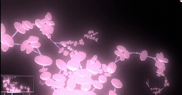
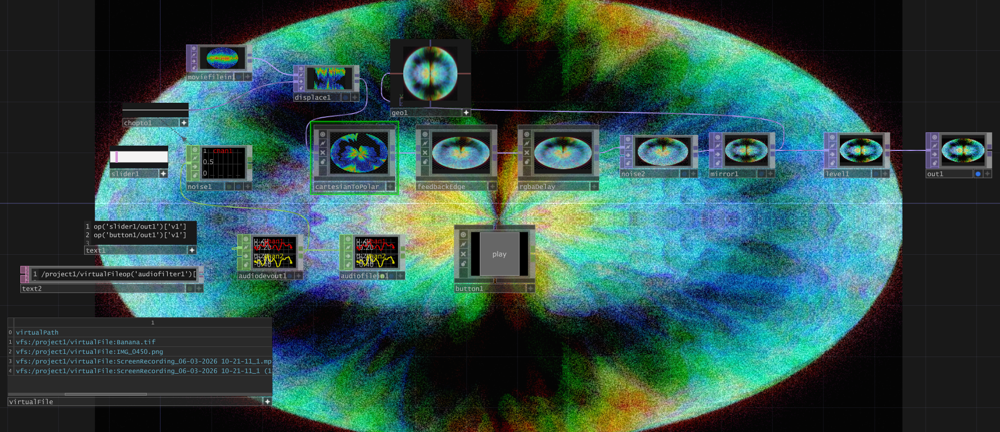
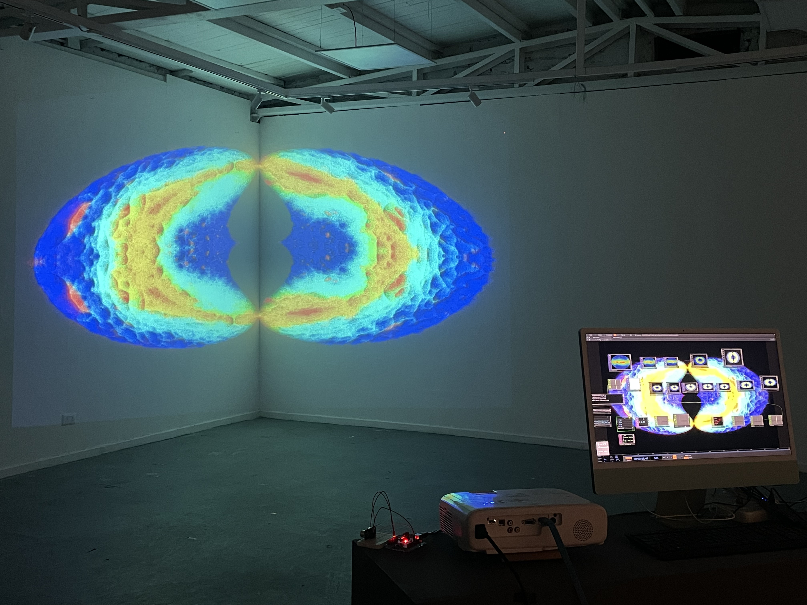
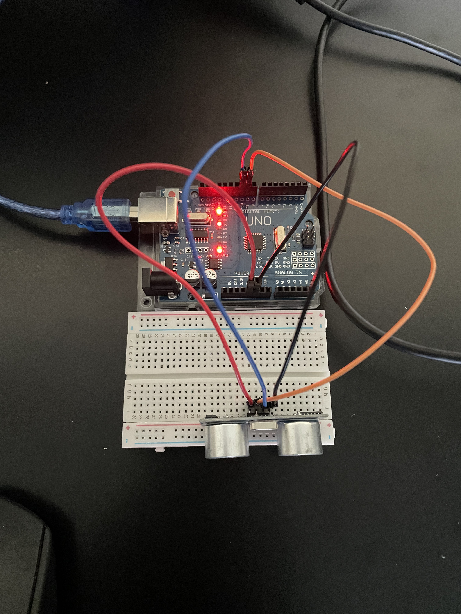
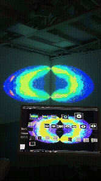
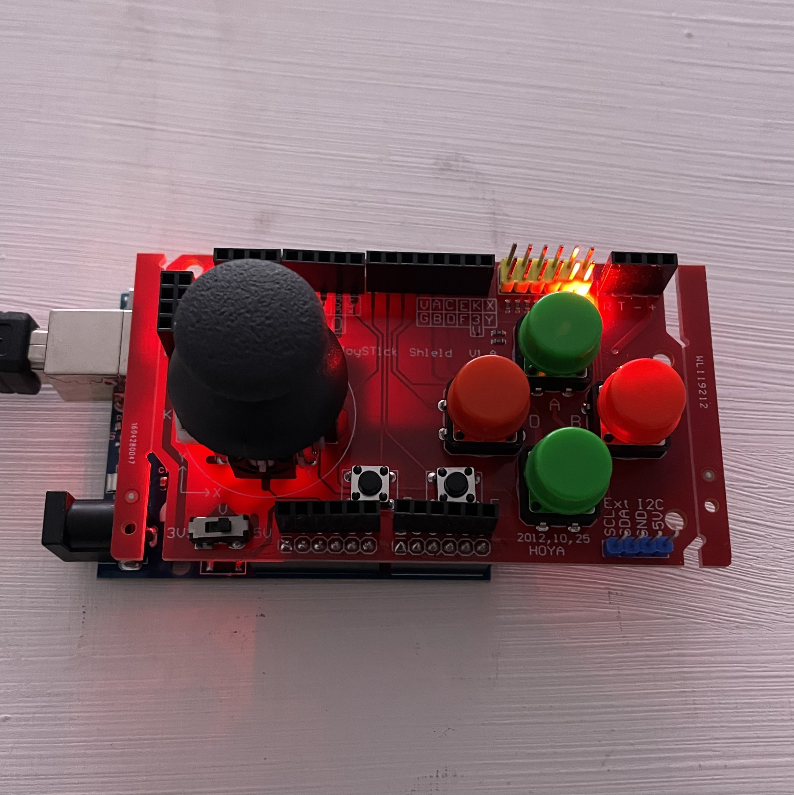
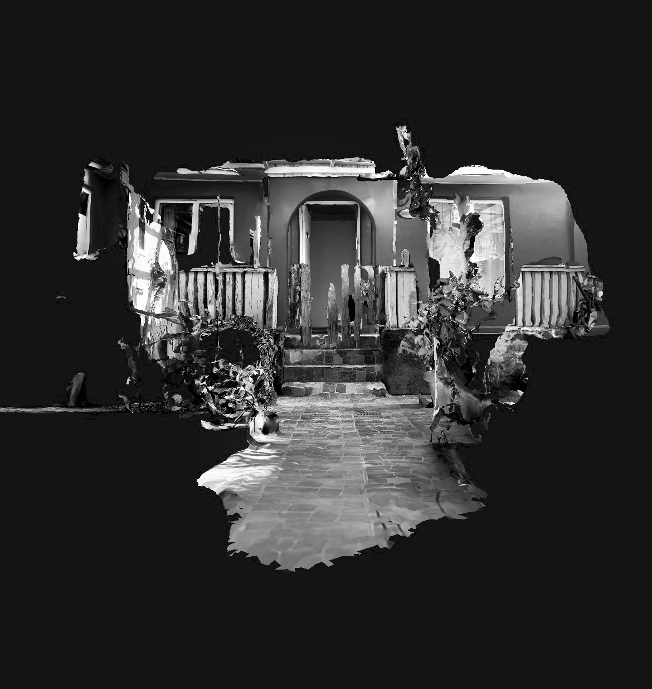
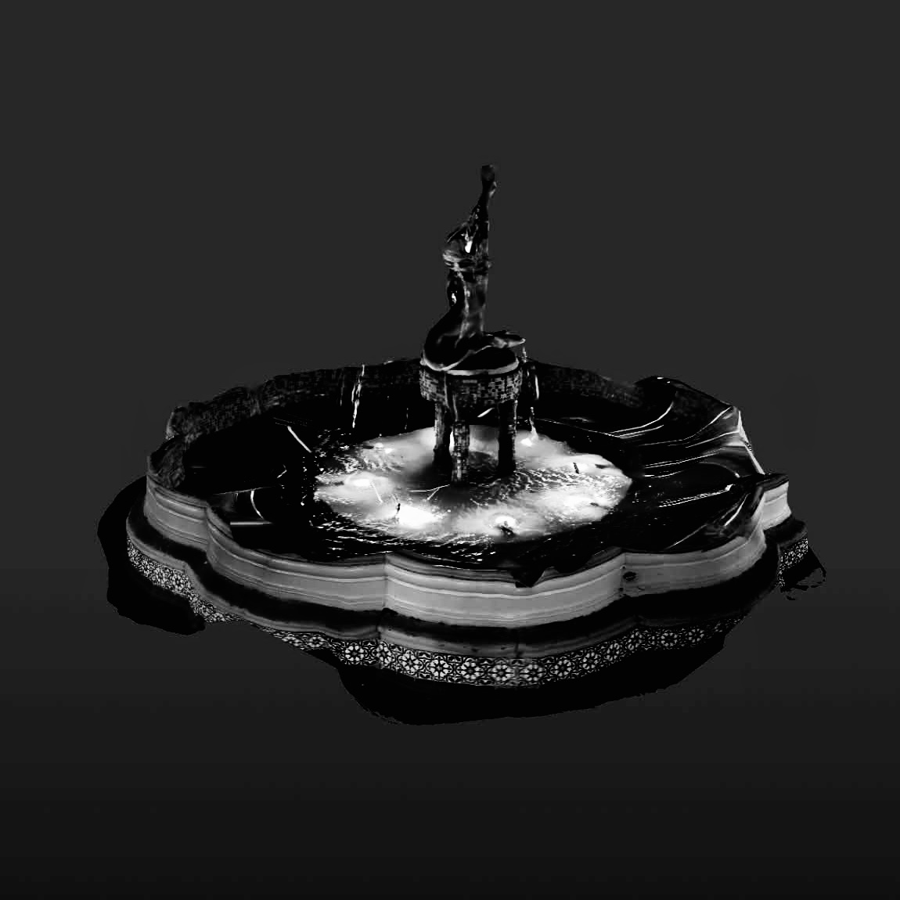
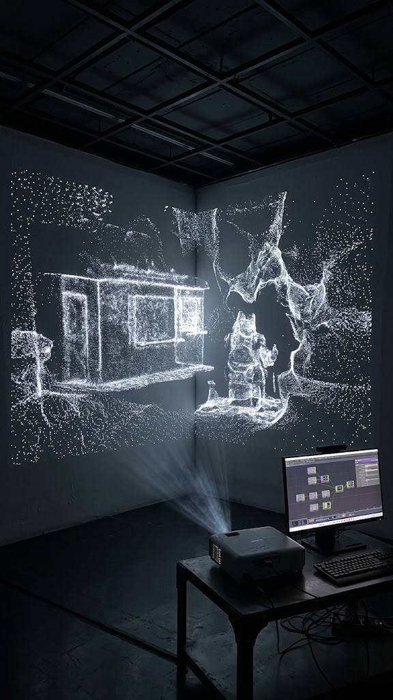

<style>
  :root{
    --bg:#0b0b0f;
    --text:#e8e8ec;
    --muted:#a0a0ab;
    --accent:#ff8fc7;
    --card:rgba(255,255,255,0.06);
    --line:rgba(255,255,255,0.14);
  }

  /* Fondo oscuro en TODOS los contenedores del tema de GitHub Pages */
  html, body, .wrapper, .container, .container-lg, .page-content, main, article,
  section, header, footer, .inner, .markdown-body, #main_content_wrap, #header_wrap {
    background: var(--bg) !important;
    color: var(--text) !important;
  }
  body{
    font-family: "Inter", "Helvetica Neue", Arial, sans-serif;
    line-height: 1.75;
    font-size: 17px;
  }
  .wrapper, .container, .inner, main, article, section{
    max-width: 880px !important;
    margin-left: auto !important;
    margin-right: auto !important;
    float: none !important;
    width: auto !important;
    padding-left: 20px;
    padding-right: 20px;
  }

  /* Títulos y texto: todos visibles sobre fondo negro */
  h1,h2,h3,h4,h5,h6,p,li,span,strong,em,td,th,figcaption{ color: var(--text) !important; }
  h1{ font-size: 3rem; letter-spacing: .08em; margin: .2em 0; color: var(--accent) !important; }
  h2{ margin-top: 2.6em; padding-bottom: .3em; border-bottom: 1px solid var(--line); }
  h3{ margin-top: 2em; color: var(--accent) !important; }
  h4{ margin-top: 1.8em; }
  a{ color: var(--accent) !important; text-decoration: underline; word-break: break-word; }
  a:hover{ opacity: .75; }
  hr{ border: 0; border-top: 1px solid var(--line); margin: 2.5em 0; }
  .subtitulo{ color: var(--muted) !important; font-size: 1.1rem; margin-bottom: 2em; }

  /* Código */
  div.highlighter-rouge, div.highlighter-rouge .highlight, div.highlighter-rouge pre,
  pre, pre code{
    background: #14141b !important;
    color: #f2f2f2 !important;
  }
  div.highlighter-rouge, pre{
    border: 1px solid var(--line);
    border-radius: 10px;
  }
  pre{ padding: 1em !important; overflow-x: auto; font-size: 14px; line-height: 1.55; }
  pre code, pre code span{ color: #f2f2f2 !important; background: transparent !important; }
  p code, li code{
    background: var(--card) !important;
    color: var(--accent) !important;
    padding: 2px 6px; border-radius: 4px;
  }

  /* Imágenes: todas con el mismo ancho y marco */
  figure{ margin: 2em 0; }
  figure img, .hero{
    display: block;
    width: 100%;
    height: auto;
    border-radius: 10px;
    border: 1px solid var(--line);
    background: #000;
  }
  figure img{
    aspect-ratio: 16 / 9;
    object-fit: contain;      /* no recorta ni deforma */
  }
  figcaption{
    margin-top: .6em;
    font-size: .88rem;
    color: var(--muted) !important;
    text-align: center;
  }

  /* Dos imágenes lado a lado (se apilan en celular) */
  .grid{
    display: grid;
    grid-template-columns: repeat(2, 1fr);
    gap: 16px;
    margin: 2em 0;
  }
  .grid figure{ margin: 0; }
  .grid figure img{ aspect-ratio: 4 / 3; }
  @media (max-width: 640px){
    .grid{ grid-template-columns: 1fr; }
    h1{ font-size: 2.2rem; }
  }

  /* Cuadros de texto con transparencia */
  .nota{
    background: var(--card);
    border: 1px solid var(--line);
    border-left: 4px solid var(--accent);
    border-radius: 10px;
    padding: 1em 1.3em;
    margin: 1.6em 0;
    backdrop-filter: blur(6px);
  }
  .nota p{ margin: .4em 0; }
  .etiqueta{
    display: inline-block;
    font-size: .75rem;
    text-transform: uppercase;
    letter-spacing: .1em;
    color: var(--accent) !important;
    margin-bottom: .4em;
  }
  .indice{ background: var(--card); border: 1px solid var(--line); border-radius: 10px; padding: 1em 1.6em; }
  .indice ul, .indice ol{ margin: .3em 0; }
</style>



# MULTIMEDIAL

<p class="subtitulo">Exploración creativa de arte, tecnología y medios digitales interactivos.</p>

<div class="indice">
<h3 style="margin-top:0">Unidad I. Hipervínculo</h3>
<ol>
  <li><a href="#mi-primera-pagina">Mi primera página</a></li>
  <li><a href="#resultados-pagina-web">Sitio Web</a></li>
</ol>
<h3>Unidad II. Programación visual creativa</h3>
<ol>
  <li><a href="#introduccion-a-touchdesigner">Intro TouchDesigner</a></li>
  <li><a href="#ejercicios">Ejercicios</a></li>
</ol>
</div>

<h2 id="unidad-i">Unidad I</h2>

### Página y vínculos

<h4 id="mi-primera-pagina">1. Mi primera página</h4>

```html
<!DOCTYPE html>
<!-- Indica al navegador que este documento usa HTML5 -->

<html>
<!-- Inicio del documento HTML -->

<head>
<!-- Sección donde van metadatos, título y estilos -->

<meta charset="UTF-8">
<!-- Define la codificación de caracteres para que se vean bien tildes y símbolos -->

<title>Multimedial</title>
<!-- Título de la página que aparece en la pestaña del navegador -->

<style>
/* Aquí comienza la sección de estilos CSS que define la apariencia visual */

body{
/* "body" se refiere a todo el contenido visible de la página */

  background-color: white;
  /* Define que el fondo de toda la página sea blanco */

  color: black;
  /* Define que el color del texto sea negro */

  margin: 0;
  /* Elimina los márgenes que los navegadores agregan por defecto */

  height: 100vh;
  /* Hace que el alto del cuerpo sea igual al 100% de la altura de la pantalla */

  display: flex;
  /* Activa el sistema Flexbox para organizar y centrar elementos */

  justify-content: center;
  /* Centra el contenido horizontalmente */

  align-items: center;
  /* Centra el contenido verticalmente */

  font-family: Arial, sans-serif;
  /* Define la tipografía del texto */

  font-size: 60px;
  /* Define el tamaño grande del texto */

}
/* Fin de las reglas de estilo del body */

</style>
<!-- Fin de la sección de estilos -->

</head>
<!-- Fin de la sección head -->

<body>
<!-- Inicio del contenido visible de la página -->

MULTIMEDIAL
<!-- Texto que aparece en el centro de la pantalla -->

</body>
<!-- Fin del contenido visible -->

</html>
<!-- Fin del documento HTML -->
```

<h4 id="resultados-pagina-web">2. Resultados página Web</h4>

<a href="https://zzof04.github.io/MULTIMEDIAL/w/index.html">https://zzof04.github.io/MULTIMEDIAL/w/index.html</a>

<h2 id="unidad-ii">Unidad II</h2>

<h3 id="introduccion-a-touchdesigner">Introducción a TouchDesigner</h3>

<h4>Link drive primeros ejercicios</h4>

<a href="https://drive.google.com/drive/folders/1H-1MCiFf7Ah3RitZw5CoLaFOJG1MuUVW?usp=drive_link">Carpeta de Google Drive: primeros ejercicios</a>

<div class="nota">
<span class="etiqueta">Reflexión</span>
<p>Comenzamos conociendo herramientas y nodos básicos como el TOP y el CHOP, además de integrar sliders y botones como herramientas de interacción. Personalmente experimenté con imágenes que ya poseía, agregándoles filtros del programa y nodos para la creación de una figura reactiva al sonido. Quise seguir desarrollando mi temática enfocada en la unión entre arte y ciencia, específicamente la astronomía.</p>
</div>

<figure>
  
  <figcaption>Ejercicio inicial</figcaption>
</figure>

<p>En paralelo al taller quise desarrollar mi proyecto de grado, con el fin de llegar a un cruce entre arte, ciencia y cómo este dialoga con la tecnología, el espacio y el espectador. Integré al proyecto un sensor ultrasónico conectado a un Arduino, para darle al cuerpo del espectador un rol activo que altera la visualidad de la obra.</p>

<figure>
  
  <figcaption>Storyboard</figcaption>
</figure>

<div class="grid">
  <figure>
    
    <figcaption>Instalación, sala 31. Proyector, computador con conexión a Arduino + sensor</figcaption>
  </figure>
  <figure>
    
    <figcaption>Conexión sensor ultrasónico</figcaption>
  </figure>
</div>

<figure>
  
  <figcaption>Prueba de interacción con el sensor</figcaption>
</figure>

<h2 id="ejercicios">Ejercicios</h2>

<h3>1. L'system</h3>

<div class="grid">
  <figure>
    
  </figure>
  <figure>
    
  </figure>
</div>

<a href="https://drive.google.com/drive/folders/1e38di-CiK1ChWk6DJTIdB44sNnNaRe1O?usp=drive_link">Carpeta de Google Drive: L'system</a>

<h3>2. Desarrollo proyecto final</h3>

<div class="nota">
<span class="etiqueta">Proceso</span>
<p>El desarrollo del proyecto anterior me permitió entender la dimensión tecnológica de mi proyecto de tesis. La integración del sensor ultrasónico a TouchDesigner significó un desafío técnico que debía comprender: ¿cómo funciona un sensor?, ¿cómo lo conecto al programa?, ¿cuál será su disposición en el montaje? Sin embargo, si bien usaba imágenes que aludían al cosmos, estas no tenían un significado más allá de su función electrónica y visual. Me pregunté qué era lo que realmente quería contar.</p>
</div>

<h4>Espacio recorrible</h4>

<p>Una de las cosas que llamó mi atención del ejercicio del L'system era su visualidad en el espacio "vacío", además de que el ejercicio contaba con un nodo <code>camera</code> que permitía cambiar la visualidad del objeto en el render.</p>

<p>Esta cualidad hizo que me preguntara por el recorrido tridimensional del objeto y pensar en este mismo como respuesta a la interacción del espectador en la obra. ¿Qué pasa si le entrego el control de recorrido al espectador dentro de un espacio digital? Aún sin llegar a la visualidad del proyecto, decidí aprender cómo podía materializar mi idea.</p>

<div class="nota">
<span class="etiqueta">Paso 1</span>
<p>Conectar un joystick conectado a Arduino a la cámara que controlaba la visualidad del render, con el fin de controlar en tiempo real el recorrido tridimensional.</p>
</div>

<p>Con la ayuda de Claude, se creó este código:</p>

```python
import math

def onFrameStart(frame):
    cam = op('/project1/container1/cam_main1')
    joy = op('/project1/sys_input/joy_raw_chop')

    if me.fetch('inicializado', False) is False:
        me.store('heading', 0.0)
        me.store('pitch', 0.0)
        me.store('smoothX', 0.0)
        me.store('smoothY', 0.0)
        me.store('centerOffsetX', 0.0)
        me.store('centerOffsetY', 0.0)
        me.store('calibrando', True)
        me.store('calibFrames', 0)
        me.store('calibSumX', 0.0)
        me.store('calibSumY', 0.0)
        me.store('posX', 0.0)
        me.store('posY', 2.0)
        me.store('posZ', -6.0)
        me.store('inicializado', True)
        return

    rawX = joy['x'][0]
    rawY = joy['y'][0]
    btnA = joy['a'][0] > 0.5
    btnB = joy['b'][0] > 0.5
    btnC = joy['c'][0] > 0.5
    btnD = joy['d'][0] > 0.5

    mapX = (rawX - 0) / (1023 - 0) * (1 - (-1)) + (-1)
    mapY = (rawY - 0) / (1023 - 0) * (1 - (-1)) + (-1)

    calibMax = 40
    if me.fetch('calibrando'):
        me.store('calibSumX', me.fetch('calibSumX') + mapX)
        me.store('calibSumY', me.fetch('calibSumY') + mapY)
        cf = me.fetch('calibFrames') + 1
        me.store('calibFrames', cf)
        if cf >= calibMax:
            me.store('centerOffsetX', me.fetch('calibSumX') / cf)
            me.store('centerOffsetY', me.fetch('calibSumY') / cf)
            me.store('calibrando', False)
        joyX, joyY = 0, 0
    else:
        joyX = aplicarRespuesta(mapX - me.fetch('centerOffsetX'))
        joyY = aplicarRespuesta(mapY - me.fetch('centerOffsetY'))

    lookSmoothing = 0.10
    smoothX = me.fetch('smoothX') + (joyX - me.fetch('smoothX')) * lookSmoothing
    smoothY = me.fetch('smoothY') + (joyY - me.fetch('smoothY')) * lookSmoothing
    me.store('smoothX', smoothX)
    me.store('smoothY', smoothY)

    turnSpeed = 1.2
    heading = me.fetch('heading') + smoothX * turnSpeed
    pitch = me.fetch('pitch') - smoothY * turnSpeed
    pitch = max(-75, min(75, pitch))
    me.store('heading', heading)
    me.store('pitch', pitch)

    moveSpeed = 0.03
    rad = math.radians(heading)
    rightX = math.cos(rad)
    rightZ = -math.sin(rad)

    targetVertical = (1 if btnA else 0) - (1 if btnC else 0)
    targetStrafe = (1 if btnB else 0) - (1 if btnD else 0)

    posX = me.fetch('posX') + rightX * targetStrafe * moveSpeed
    posZ = me.fetch('posZ') + rightZ * targetStrafe * moveSpeed
    posY = me.fetch('posY') + targetVertical * moveSpeed

    me.store('posX', posX)
    me.store('posY', posY)
    me.store('posZ', posZ)

    cam.par.rx = pitch
    cam.par.ry = heading
    cam.par.tx = posX
    cam.par.ty = posY
    cam.par.tz = posZ

    return


def aplicarRespuesta(v):
    deadzone = 0.07
    curve = 1.6
    if abs(v) < deadzone:
        return 0
    signo = -1 if v < 0 else 1
    mag = (abs(v) - deadzone) / (1 - deadzone)
    mag = max(0, min(1, mag))
    mag = mag ** curve
    return signo * mag
```

<div class="grid">
  <figure>
    
    <figcaption>Joystick Shield</figcaption>
  </figure>
  <figure>
    
    <figcaption>Objetos dentro del espacio digital</figcaption>
  </figure>
</div>

<figure>
  
  <figcaption>Recorrido tridimensional controlado con el joystick</figcaption>
</figure>

<div class="nota">
<span class="etiqueta">Paso 2</span>
<p>Con el control técnicamente armado, mi próximo paso fue integrar más "objetos" dentro del espacio digital.</p>
</div>

<h4>Estrellas y el pasado</h4>

<p>El desarrollo poético de la obra me hizo replantear mi mirada sobre el cosmos.</p>

<div class="nota">
<span class="etiqueta">Punto de partida</span>
<p>El universo y mis ganas por representarlo me llevaron a mi punto de partida, mi hogar de origen, gracias a la pregunta de mi tío hace más de ocho años: <em>¿sabías que cuando miramos las estrellas, realmente vemos la luz de su pasado?</em> A raíz de esto, me pregunté por aquella distancia y el tiempo que separa al observador. Tanto la luz de una estrella como mi casa natal son un pasado que aún llega hasta mí.</p>
</div>

<p>Mi casa natal se manifiesta de forma intangible, a través del recuerdo y los sueños. Metodológicamente, necesitaba encontrar una manera de volver a recorrer aquellos recuerdos, y así di con una aplicación llamada Scaniverse, una plataforma inmersiva que permite, gracias a la tecnología LiDAR, escanear espacios y objetos físicos y llevarlos a modelos 3D detallados y de alta resolución. Su carácter gratuito y su facilidad de manejo me permitieron compartirla con alguien en mi ciudad natal. Para recolectar estos espacios, mi amiga de la infancia se dio la tarea de realizar un recorrido y habitar los mismos espacios que yo frecuentaba, escaneando pasillos, esculturas y espacios, cada uno cargado de significado emocional y biográfico.</p>

<p>Una de las características visuales de esta herramienta es que los escáneres no siempre quedan perfectos: hay partes que se fragmentan y datos que se pierden, generando una imagen incompleta. Lejos de significar un error, lo tomo como una cualidad visual clave.</p>

<div class="grid">
  <figure>
    
    <figcaption>Escáner "casa" (Scaniverse)</figcaption>
  </figure>
  <figure>
    
    <figcaption>Escáner "fuente" (Scaniverse)</figcaption>
  </figure>
</div>

<p>Estos escáneres se exportan en formato PLY, un formato de archivo 3D que almacena objetos gráficos en una colección de vértices, caras e incluso propiedades de color, que luego son leídos en TouchDesigner y traducidos a un sistema de puntos. En este paso, los lugares físicos se vuelven un dato programable que luego pasa a imagen.</p>

<figure>
  
  <figcaption>Red de nodos en TouchDesigner</figcaption>
</figure>

<figure>
  
  <figcaption>Recorrido por el espacio escaneado</figcaption>
</figure>

<h3>3. Comfy Desktop / prompt</h3>

<p>Aprendimos el uso del programa Comfy Desktop para la creación de imágenes con inteligencia artificial, con el fin de crear visuales que inspiren nuestros proyectos en TouchDesigner, además de visualizar opciones de montaje, bocetos, etc. Para mi proyecto decidí generar opciones de montaje. Le pedí a la IA (Claude) la creación de las imágenes adjuntando los bocetos de referencia hechos a mano:</p>

```text
A partir de las imágenes de referencia crea una imagen realista de cada una considerando: los bocetos se tratan de una instalación artística donde se proyecta, a oscuras, un proyecto visual en una sala blanca rectangular. Las imágenes que se proyectan corresponden a espacios físicos tridimensionales llevados a un sistema de puntos que resalta en contraste con el espacio oscuro, como la referencia. Estos se encuentran en un espacio digital mediado por el programa Touchdesigner.
En la imagen 1, se muestra esta proyección cubriendo todo el espacio de la pared en vista frontal. Al frente, se sitúa un plinto donde descansa un joystick conectado a Arduino a la altura óptima donde el espectador sea capaz de manipularlo. En la segunda imagen se muestra la proyección hacia una esquina de la sala, enfocando el proyector y el monitor donde corre el programa Touchdesigner.
```

<p>Me arrojó 2 prompts que luego pasé por Gemini:</p>

<h4>Imagen 1</h4>

```text
Photorealistic interior photograph of a minimalist rectangular white gallery
room, completely dark, front view centered on the back wall. The entire wall is
covered by a large projection of a 3D point cloud: thousands of tiny glowing white
and slightly iridescent dots forming volumetric architectural spaces and organic
shapes, like a LiDAR or photogrammetry scan, sharp contrast against the black. In
the foreground, centered, a slim white plinth at waist height with an arcade-style
joystick connected to an Arduino board with thin wires, softly lit by the spill light of the
projection. Floor reflects faint dots of light. Symmetrical one-point perspective,
cinematic, long exposure, ultra-detailed, 35mm, f/2.8, contemporary art installation
documentation.
```

<figure>
  
  <figcaption>Imagen generada en Comfy Desktop</figcaption>
</figure>

<h4>Imagen 2</h4>

```text
Photorealistic photograph of the corner of a dark white-walled exhibition
room, wide angle. A point-cloud projection of 3D scanned spaces (glowing white dots
on black) wraps across both walls of the corner, continuing seamlessly over the
vertical edge. A video projector sits on a low table in the foreground, emitting a
visible light beam through light haze, next to a desktop monitor and keyboard
running TouchDesigner, showing a node network with connected rectangular
operators, its screen glow lighting the table. Dark ceiling with a visible grid. Moody,
low-light, cinematic, high contrast, art installation documentation photo, 24mm lens.
```

<figure>
  
  <figcaption>Imagen generada en Comfy Desktop</figcaption>
</figure>
