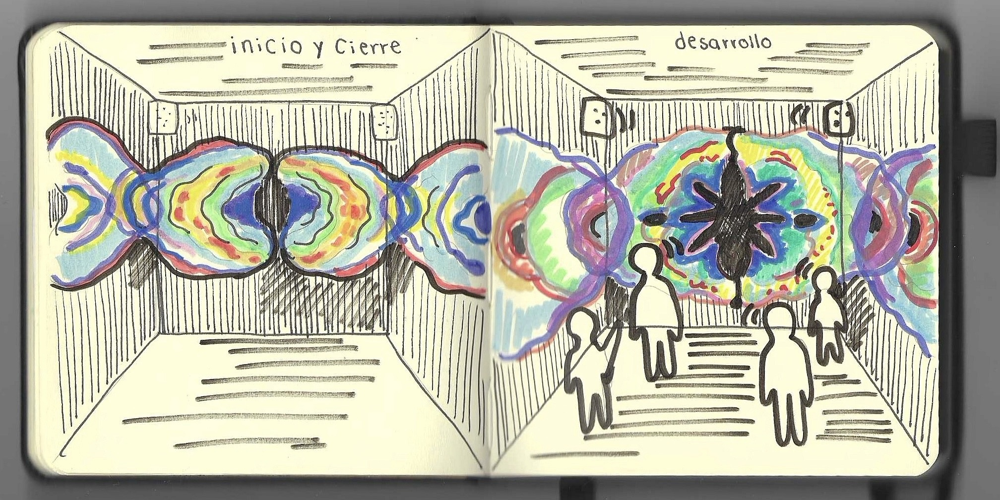
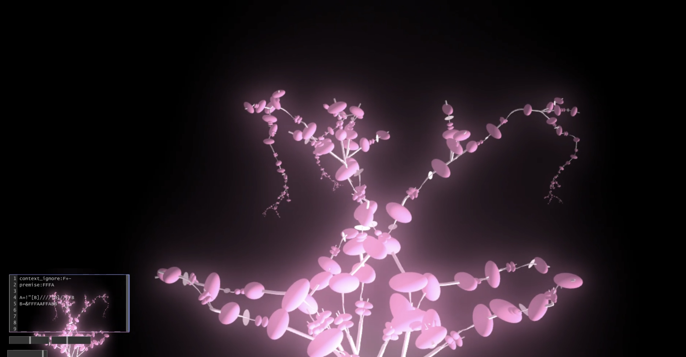

# <span style="color: pink;">MULTIMEDIAL</span>

#### Exploración creativa de arte, tecnología y medios digitales interactivos.


### Unidad I. Hipervínculo

1. Mi primera página
2. Sitio Web 

### Unidad II. Programación visual creativa

1. Intro TouchDesigner
2. Ejercicios

## Unidad I

### Página y vínculos

#### 1. Mi primera página: 

```js
<!DOCTYPE html>
<!-- Indica al navegador que este documento usa HTML5 -->

<html>
<!-- Inicio del documento HTML -->

<head>
<!-- Sección donde van metadatos, título y estilos -->

<meta charset="UTF-8">
<!-- Define la codificación de caracteres para que se vean bien tildes y símbolos -->

<title>Multimedial</title>
<!-- Título de la página que aparece en la pestaña del navegador -->

<style>
/* Aquí comienza la sección de estilos CSS que define la apariencia visual */

body{
/* "body" se refiere a todo el contenido visible de la página */

  background-color: white;
  /* Define que el fondo de toda la página sea blanco */

  color: black;
  /* Define que el color del texto sea negro */

  margin: 0;
  /* Elimina los márgenes que los navegadores agregan por defecto */

  height: 100vh;
  /* Hace que el alto del cuerpo sea igual al 100% de la altura de la pantalla */

  display: flex;
  /* Activa el sistema Flexbox para organizar y centrar elementos */

  justify-content: center;
  /* Centra el contenido horizontalmente */

  align-items: center;
  /* Centra el contenido verticalmente */

  font-family: Arial, sans-serif;
  /* Define la tipografía del texto */

  font-size: 60px;
  /* Define el tamaño grande del texto */

}
/* Fin de las reglas de estilo del body */

</style>
<!-- Fin de la sección de estilos -->

</head>
<!-- Fin de la sección head -->

<body>
<!-- Inicio del contenido visible de la página -->

MULTIMEDIAL
<!-- Texto que aparece en el centro de la pantalla -->

</body>
<!-- Fin del contenido visible -->

</html>
<!-- Fin del documento HTML -->
```

#### 2. Resultados página Web

 https://zzof04.github.io/MULTIMEDIAL/w/index.html 

## Unidad II

### Introducción a TouchDesigner.

#### Link drive primeros ejercicios.

https://drive.google.com/drive/folders/1H-1MCiFf7Ah3RitZw5CoLaFOJG1MuUVW?usp=drive_link 

```text 
Comenzamos conociendo herramientas y nodos básicos como el TOP, CHOP, además de integrar sliders y botones como herramientas de interacción. Personalmente experimenté con imágenes que ya poseía, agregándole filtros de imágenes del programa y nodos para la creación de una figura reactiva al sonido. 
```
 Ejercicio inicial

En paralelo al taller quise desarrollar mi proyecto de grado. Esto con el fin de llegar a un cruce entre arte, ciencia y cómo este dialoga con la tecnología, espacio y espectador. 
Integré al proyecto un sensor ultrasónico conectado a un Arduino, con el fin de darle al cuerpo del espectador un rol activo que altera la visualidad de la obra.  

 Storyboard

 Instalación, sala 31.
Proyector, computador con conexión a arduino + sensor

 Conexión sensor ultrasónico

<gif src="https://raw.githubusercontent.com/zzof04/MULTIMEDIAL/refs/heads/main/gif/Adobe%20Express%20-%20IMG_1005.gif"width="auto" height="auto"/> C

### Ejercicios.

#### 1. L'system

 

 

#### Link Drive
https://drive.google.com/drive/folders/1e38di-CiK1ChWk6DJTIdB44sNnNaRe1O?usp=drive_link 

#### 2. Comfy desktop / prompt

Le pedí a la ia (Claude) la creación de las imágenes adjuntando los bocetos de
referencia:

```text
A partir de las imágenes de referencia crea una imagen realista de cada una
considerando: los bocetos se tratan de una instalación artística donde se proyecta, a
oscuras, un proyecto visual en una sala blanca rectangular. Las imágenes que se
proyectan corresponden a espacios físicos tridimensionales llevados a un sistema
de puntos que resalta en contraste con el espacio oscuro, como la referencia. Estos
se encuentran en un espacio digital mediado por el programa Touchdesigner. En la
imagen 1, se muestra esta proyección cubriendo todo el espacio de la pared en vista
frontal. Al frente, se sitúa un plinto donde descansa un joystick conectado a Arduino
a la altura óptima donde el espectador sea capaz de manipularlo. En la segunda
imagen se muestra la proyección hacia una esquina de la sala, enfocando el
proyector y el monitor donde corre el programa Touchdesigner.
```

Me arrojó 2 prompts que luego pasé por Gémini:

#### imagen 1: 
```text
Photorealistic interior photograph of a minimalist rectangular white gallery
room, completely dark, front view centered on the back wall. The entire wall is
covered by a large projection of a 3D point cloud: thousands of tiny glowing white
and slightly iridescent dots forming volumetric architectural spaces and organic
shapes, like a LiDAR or photogrammetry scan, sharp contrast against the black. In
the foreground, centered, a slim white plinth at waist height with an arcade-style
joystick connected to an Arduino board with thin wires, softly lit by the spill light of the
projection. Floor reflects faint dots of light. Symmetrical one-point perspective,
cinematic, long exposure, ultra-detailed, 35mm, f/2.8, contemporary art installation
documentation.
```

#### imagen 2: 
```text
Photorealistic photograph of the corner of a dark white-walled exhibition
room, wide angle. A point-cloud projection of 3D scanned spaces (glowing white dots
on black) wraps across both walls of the corner, continuing seamlessly over the
vertical edge. A video projector sits on a low table in the foreground, emitting a
visible light beam through light haze, next to a desktop monitor and keyboard
running TouchDesigner, showing a node network with connected rectangular
operators, its screen glow lighting the table. Dark ceiling with a visible grid. Moody,
low-light, cinematic, high contrast, art installation documentation photo, 24mm lens.
```
